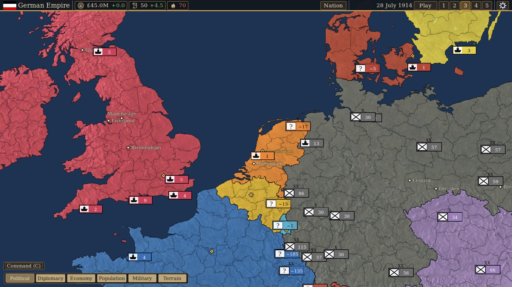
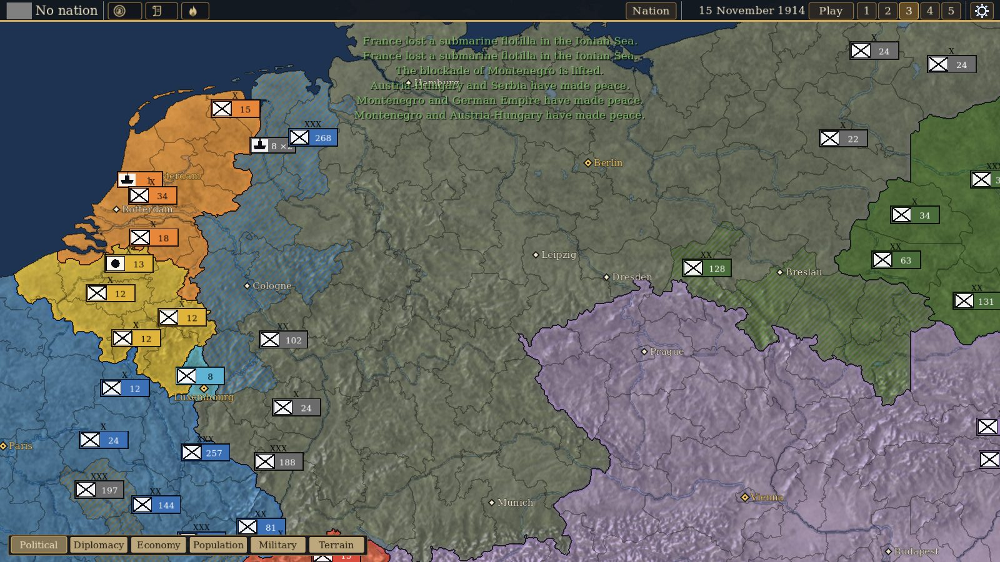
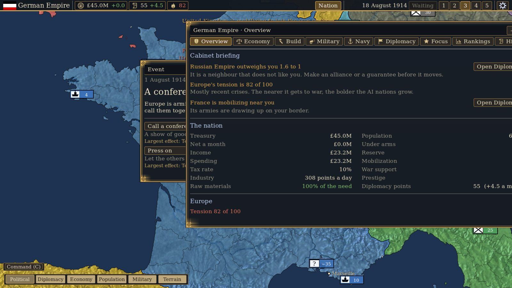
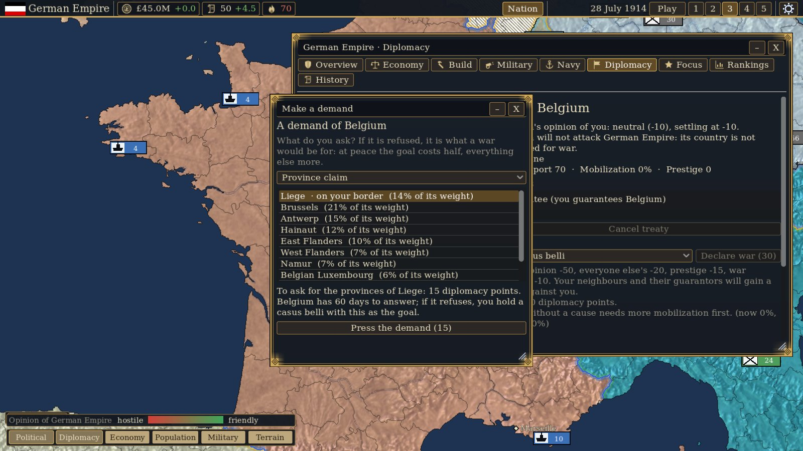
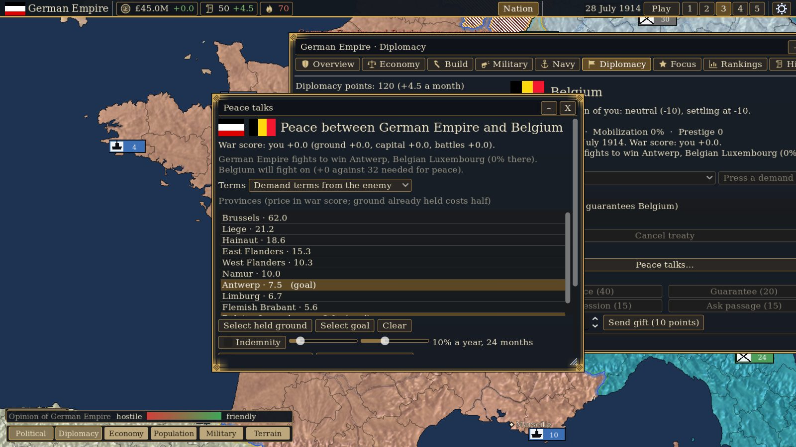

# Foreign Skies

A real-time historical-pressure sandbox on a map of Europe (flat, or in 3D with real terrain relief).
Start in January 1900, at peace, or in July 1914 with the crisis already under way. Pick any of 22 nations,
run its economy, armies, navy, diplomacy and national focus, and steer through the crises that pushed the
great powers toward war. Europe's tension rises with the arms race and rivalry; events put choices to you; the
AI plays every other nation. There is no score and no ending: it is an open sandbox, and whether the great war comes is up to you and them. The design is
in [DESIGN.md](DESIGN.md); [MANUAL.md](MANUAL.md) is a player's guide, and [CHANGELOG.md](CHANGELOG.md) lists what changed.



| | |
|---|---|
|  |  |
|  |  |

## Running it

You need [Godot 4.7.2](https://godotengine.org/) (the project is set to 4.7, GL Compatibility renderer; the tests and the CI check run on 4.7.2).

1. Open the project folder in Godot and press F5, or run `godot --path .` from this folder.
2. The first launch imports the map images; wait for it to finish.
3. On the main menu choose **New game** and a scenario (January 1900 or July 1914), or **Tutorial**, a guided intro in 1900; then a nation.

Saves and settings are written to Godot's user folder (`user://saves/`, `user://settings.cfg`).

## Playing

| Input | Does |
|---|---|
| W A S D, wheel, middle-drag | Pan and zoom the map |
| Click | Select a province (or army, fleet, sea zone) |
| Right click | Order selected armies or fleets; otherwise open the Nation screen on your own land, or the country panel on another nation |
| Box drag | Select every army and fleet inside the box |
| Space, `-` `+` | Pause, change speed (five speeds) |
| 1 to 6 | Map modes (political, diplomacy, economy, population, military with its sea control and blockade variants, terrain) |
| C | Show or hide the command panel (armies and fleets as cards along the bottom) |
| N | The Nation screen, on its Overview. Its tabs have their own letters: E Economy, B Build, M Military, Y Navy, F Diplomacy, O Focus, R Rankings, H History (a letter opens the screen on that tab and, pressed again, closes it) |
| V | Switch the 3D map on or off. Page Up and Page Down tilt it, `[` and `]` turn it, Home resets; Settings has the 3D map's quality |
| F5, Shift+F5, F6 | Quick save, quick load, save and load window |
| F10, Ctrl and `+` `-` | Settings, UI scale |
| Esc | Clear a selection, otherwise the pause menu (which also lists the keys) |

The game saves itself on the first of every month into three rotating autosave slots.

## Testing

Every test is a headless script under `tests/`:

```
godot --headless --path . -s res://tests/save_load_test.gd      # one test
python tools/run_tests.py                                       # all the headless ones
python tools/run_tests.py --windowed                            # and the ones that need a window (virtual display)
GODOT=/path/to/godot python tools/run_tests.py save_load menu   # a few, with the executable named
```

A test passes when it prints `FAILURES: 0`. Tests marked `## WINDOWED` need a real window (headless Godot does not dispatch mouse events) and run only with `--windowed`, under `xvfb-run`. `SPEED_TESTS=0` skips the checks on how long a day takes, for a slow or busy machine. The CI check (`.github/workflows/tests.yml`) does both.

`python tools/validate_data.py` checks the data files for what only shows up in play (an event waiting for an event that does not exist, a claim on a province that is not on the map, a trained AI parameter missing from `ai.json`, a playlist naming a missing piece) and exits 1 with the list of problems; `python -m unittest discover -s tools -p "test_*.py"` tests the Python tools (the trainer's number handling and the validator). The CI check runs both.

Two long soak runs look for the bugs a short test misses: `godot --headless --path . -s res://tools/soak.gd -- <seed> <nation> <years>` plays the whole AI game with random commands and checks the state's invariants every month; `tools/ui_soak.gd` does random clicks, keys and windows in the real scene (run it under `xvfb-run`). `tools/profile_days.gd` times each part of the daily step over an AI run; `tools/balance_run.gd` prints a yearly table of the great powers, tension and wars for a long AI-only run (the balance check); `tools/late_report.gd` counts the AI's wars, treaties and foci year by year.

 Run `godot --headless --path . --import` once after
adding a new script with a `class_name`, so Godot learns the class. `tests/playthrough_test.gd`
plays a hundred days at four nations in the real map scene and prints the load time, memory and the
cost of a day; `tools/ai_report.gd` plays the whole AI war and prints a month-by-month report.

## Training the AI

The AI's numbers (`data/ai.json`) were tuned by self-play, with no scripted plans: `python tools/ai_train.py run 10` trains from the saved state in `tools/ai_training/` (set `GODOT`, and `WORKERS` for the games played at once), `python tools/ai_train.py test 16` plays the trained numbers against the starting ones on fresh seeds, and `apply` writes them into `data/ai.json`. `tools/ai_watch.gd`, `ai_wars.gd`, `ai_battles.gd`, `ai_scoreboard.gd` and `war_length.gd` show what the AI is doing.

## Layout

| Folder | Holds |
|---|---|
| `scripts/sim/` | The simulation: `GameState`, the clock, economy, military, navy, diplomacy, commands, saving |
| `scripts/ai/` | The AI: defence, offence, navy, landings, diplomacy, budget, focus and ambition |
| `scripts/map/` | Map data, the map view and its shader, army and fleet layers |
| `scripts/ui/` | Panels, windows, menus, tutorial |
| `scripts/audio.gd` | Sound and the music player (the `Audio` autoload) |
| `data/` | Map bitmaps and tables, scenarios, balance files (`economy.json`, `military.json`, `navy.json`, `ai.json`, `diplomacy.json`, `focus.json`, ...), `audio.json`, `tutorial.json` |
| `tools/` | Build scripts for the map data and audio, the test runner, the AI trainer (`ai_train.py`, `ai_arena.gd`) and screenshot tools |
| `tests/` | The headless tests |

Everything that can be a number is in `data/`. All changes to the world go through commands
(`GameState.issue`), which is what makes saves, tests and the AI share one path.

## The trailer

`tools/trailer.gd` renders a one-minute trailer from the game itself with Godot's movie writer (every frame is the game's own, with
its music): `xvfb-run -a -s "-screen 0 1600x900x24" godot --path . --rendering-driver opengl3 --resolution 1600x900 --write-movie
trailer.avi --fixed-fps 30 -s res://tools/trailer.gd`, then `ffmpeg -i trailer.avi -c:v libx264 -crf 23 -pix_fmt yuv420p -c:a aac
trailer.mp4`. It takes a few minutes; pass `-- quick` after the script for a short check run.

## Rebuilding generated data

Python 3 scripts in `tools/` build the map tables and the stock sounds (`python tools/make_audio.py`
writes the sound effects in `data/audio/`; the music in `data/audio/music/` is the three supplied pieces). `tools/extend_map.py`
adds a region to the map bitmap (Natural Earth admin-1 data), `tools/add_scandinavia.py` its population,
resources and terrain, and `tools/build_relief.py` the 3D map's heightmap (open elevation tiles). They need
`numpy`, `scipy`, `shapely`, `pyshp` and `Pillow`.

## Windows export

Install the export templates through *Editor > Manage Export Templates*, add a Windows Desktop
preset under *Project > Export*, and export. `export_presets.cfg` is not committed.
